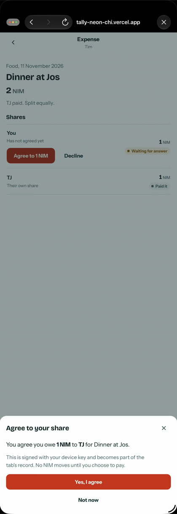
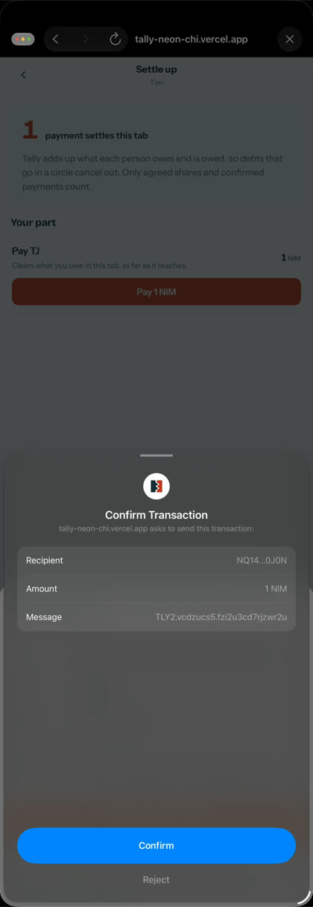
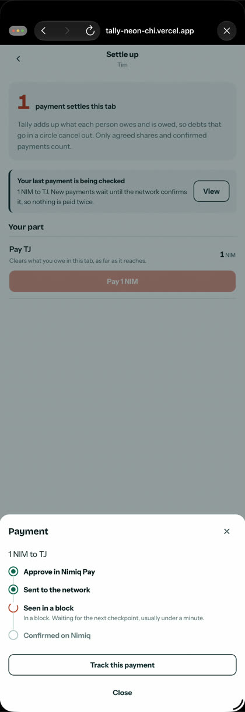
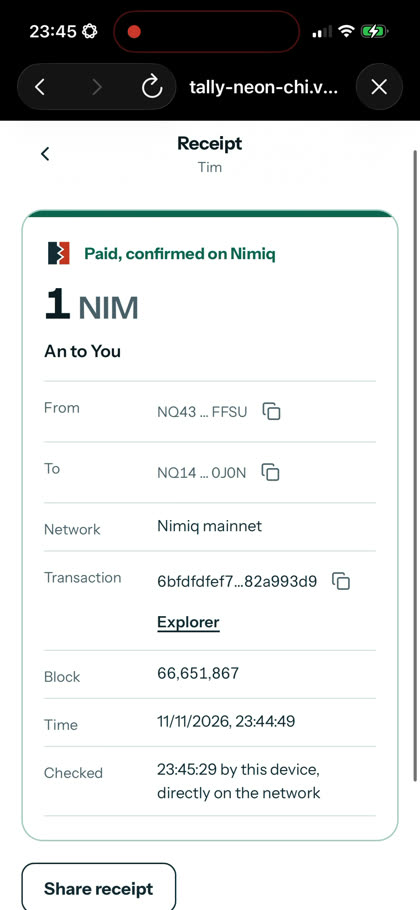

<p></p>

**Shared expenses. Actually settled.** A Nimiq Pay Mini App that keeps one tab for a group, gets every share agreed by the person who owes it, cuts circular debts down to the fewest NIM payments, and only marks a payment paid once it has found it on the Nimiq network.

**[Open the app](https://tally-neon-chi.vercel.app)** · **[Watch the 2-minute demo](https://youtu.be/-h1qpekaeXE)** · Nimiq mainnet · MIT

<p>




</p>

Real screens from two Nimiq Pay wallets on mainnet: agreeing to a share, Nimiq Pay's own approval prompt, the payment timeline, and the confirmed receipt.

## Who it is for

Two to twelve people who keep spending together and already use NIM: a trip, a shared flat, a team lunch, a weekly dinner. Someone covers the bill, everyone says "I'll send it", and a week later the person who paid is scrolling the group chat working out who did. A spreadsheet says who owes whom. It does not say who actually paid.

## Using it

1. Open `https://tally-neon-chi.vercel.app` in Nimiq Pay (Mini Apps, then Custom URL), or tap `https://nimpay.app/miniapps/open/tally-neon-chi.vercel.app/app` on your phone.
2. Sign in: Nimiq Pay asks you to share your account, then to sign one message that lets this device record your agreements. It cannot move NIM.
3. Start a tab and share the invite. Others open it in Nimiq Pay and join.
4. Whoever paid adds the expense and how to split it (equally, exact amounts or percentages, exact to the Luna).
5. Each person agrees to their share or declines it. Nothing is owed until they agree.
6. **Settle up** shows the fewest payments that clear the tab. You pay your part in Nimiq Pay; the receipt says *Paid, confirmed on Nimiq* only after Tally has found it on chain.

In a normal browser the site explains Tally and hands you to Nimiq Pay. It never pretends a wallet is connected.

## How it uses Nimiq Pay and NIM

| What | Where |
| --- | --- |
| Wallet port over `@nimiq/mini-app-sdk` 0.2.5: `listAccounts` (wallet address plus the rotating spending HTLC), `sign`, `getBalance`, `sendBasicTransactionWithData`, `accountsChanged`, typed `NimiqProviderError` handling | [`packages/app/src/lib/wallet/nimiq-pay.ts`](packages/app/src/lib/wallet/nimiq-pay.ts) |
| Identity is the address derived from the signature's public key, never `listAccounts()[0]` | [`packages/app/src/lib/identity.ts`](packages/app/src/lib/identity.ts) |
| Payments: intent saved before the prompt, payer-bound memo `TLY2.<tab>.<ref>`, unknown outcomes reconciled by finding the memo on chain, no second payment while one is unresolved | [`packages/app/src/lib/payments.ts`](packages/app/src/lib/payments.ts) |
| A payment counts only when the chain shows the right recipient, exact amount, network, memo, successful execution and macro-block finality | [`packages/core/core/settle/index.ts`](packages/core/core/settle/index.ts) |
| Netting: pairwise collapse, cycle cancellation, greedy matching, all in integer Luna | [`packages/core/core/netting/index.ts`](packages/core/core/netting/index.ts) |

The worked example Tally has always published still holds and is a fixed test: Ada owes Bo 500, Bo owes Cy 500, Cy owes Ada 500, Ada owes Dee 1200, Bo owes Dee 300. Five debts become two payments (Ada to Dee 1200, Bo to Dee 300) and Cy pays nothing. Savings depend on how a group's debts connect; the plan never needs more than one payment fewer than the number of people.

## Verified on mainnet

On 11 November 2026 two Nimiq Pay wallets (Nimiq Pay 2.23.0) used the deployed app on mainnet: created a tab, joined it, recorded shared expenses, agreed to the shares and settled them.

| Payment | Amount | Sent from | Memo on chain | Result |
| --- | --- | --- | --- | --- |
| [`457faf49…3f075205`](https://nimiq.watch/#457faf4916dc9661fe63799fb3e678c0f532cae16220c7c5e3a997663f075205) | 0.5 NIM, fee 0 | payer's Nimiq Pay HTLC | `TLY2.vcdzucs5.eazfimihzxfho3er` | in a block 3 s after the intent was saved, confirmed after finality about 61 s later |
| [`6bfdfdfe…82a993d9`](https://nimiq.watch/#6bfdfdfef71c66c3d5c590aa904c974e9f10bd428f8b59a997c6371582a993d9) | 1 NIM, fee 0 | payer's Nimiq Pay HTLC | `TLY2.vcdzucs5.fzi2u3cd7rjzwr2u` | block 66,651,867, shown as paid on both devices after finality ([demo](https://youtu.be/-h1qpekaeXE)) |

Both payments were confirmed independently by each device's own chain check and by the server's reconciler. These are payments between the builder's own wallets: they show the path works end to end, not usage.

## Run it locally

```bash
pnpm install
pnpm -r test                                   # core, app, server (needs a local Postgres)
createdb tally_dev && pnpm --filter @tally/server build
DATABASE_URL=postgresql://localhost/tally_dev node packages/server/dist/migrate.js
DATABASE_URL=postgresql://localhost/tally_dev CORS_ORIGINS=http://localhost:5174 node packages/server/dist/index.js
VITE_API_URL=http://localhost:8080 pnpm --filter @tally/app dev
```

Open `http://localhost:5174/app?preview=ada` (and `?preview=bo` in another browser profile) to click through with a development-only preview wallet that signs but cannot send. It is excluded from production builds. Deployment: [DEPLOY.md](DEPLOY.md).

## What is new for Cycle III

Tally was entered in Cycle I and did not win. This is a rebuild of that entry, in the same repository with its history intact.

| Cycle I | Cycle III |
| --- | --- |
| Testnet only | Nimiq mainnet, with a live payment above |
| Auto-settle from an app-held "purse" key, deterministic transaction bytes | Purse switched off: Nimiq Pay now pays from a co-signed, rotating HTLC, and a hot key on the phone is too easy to lose. Every payment is approved in Nimiq Pay ([`df6d6ba`](https://github.com/winsznx/tally/commit/df6d6ba)) |
| SDK 0.1.0, payer identified from the returned transaction's sender | SDK 0.2.5, identity proven by signature, HTLC tracked separately, typed wallet errors ([`df6d6ba`](https://github.com/winsznx/tally/commit/df6d6ba)) |
| A round could expire after partial payment and re-count paid debts | Chain-verified payments net as reverse debts, so a stale plan or duplicate send leaves a visible credit, never a double charge ([`d8471b0`](https://github.com/winsznx/tally/commit/d8471b0)) |
| Pairwise "owes" entries only | Expenses with equal, exact or percentage splits, creditor withdraw and forgive, display names ([`d8471b0`](https://github.com/winsznx/tally/commit/d8471b0)) |
| A failed-but-included transaction could read as paid | `executionResult`, recipient, amount, memo and finality all checked ([`d8471b0`](https://github.com/winsznx/tally/commit/d8471b0)) |
| Cloudflare Worker + D1 relay | Fastify + Postgres API with idempotent appends, append-only storage and a chain reconciler ([`3b8b1cb`](https://github.com/winsznx/tally/commit/3b8b1cb)) |
| Single-file vanilla UI, placeholder QR | Rebuilt React app and seven-section site, new identity, real scannable invites ([`8777288`](https://github.com/winsznx/tally/commit/8777288), [`d705401`](https://github.com/winsznx/tally/commit/d705401)) |

The Cycle I security fixes in [REVIEWS.md](REVIEWS.md) still hold and their regression tests still pass.

## Limits, stated plainly

- Anyone with a tab's link can read it. Payments are public on chain, like all Nimiq payments.
- A display name is what someone typed; the wallet signature proves the address, not the person.
- Tally records and verifies. It cannot make anyone pay.
- The device key that signs your agreements lives in the app's storage. It holds no funds, but someone who controls your phone could agree to a request as you. See [SECURITY.md](SECURITY.md).
- Tabs you have opened are listed on that device only. On a new device, open the invite link again.
- The API currently uses an sslip.io hostname rather than a custom domain.

## Repository

`packages/core` netting, signed log, settlement verification · `packages/app` the Mini App and site · `packages/server` the API · `packages/relay` the Cycle I relay, kept for reference. Background: [ARCHITECTURE.md](ARCHITECTURE.md) (Cycle I design), [DECISIONS.md](DECISIONS.md), [SECURITY.md](SECURITY.md), [REVIEWS.md](REVIEWS.md).

MIT licensed.
